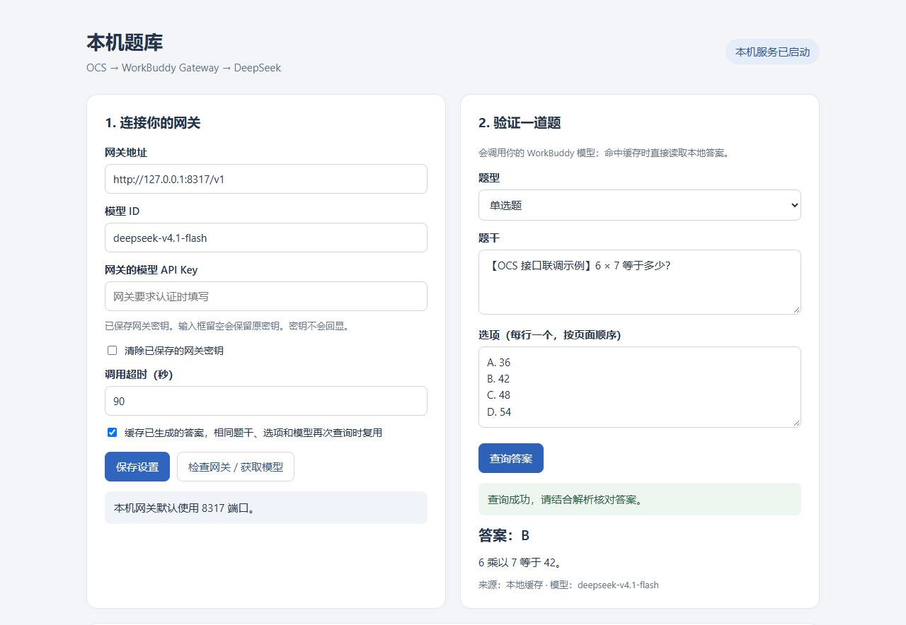

# OCS 本机 AI 题库

[](https://github.com/gyf1766153133-ui/ocs-workbuddy-qbank/actions/workflows/test.yml)
[](LICENSE)

把自己的模型 API 接到 OCS 自定义题库，支持 **WorkBuddy Gateway + DeepSeek**，也可以填写其他 OpenAI 兼容接口。

```text
OCS → 本机题库 → 你的模型 API / WorkBuddy Gateway → 模型答案
```

在本机设置页填入 API 地址、模型 ID 和自己的 API Key，即可生成 OCS 配置。无需修改源代码，也无需安装 npm 依赖。



## 功能

- 支持单选、多选、判断、填空和简答题；支持通过图片输入读取公式图、题目图片和选项图片。
- 单题查询显示答案与解析，便于先检查接口和答案。
- 自动生成 OCS 配置，支持 `GM_xmlhttpRequest` 和 `fetch`。
- 本地缓存重复题目，可删除错答缓存并导出题库 JSON。
- 网关 API Key 保存在本机，OCS 配置使用另一枚独立的本地令牌。
- 仅监听 `127.0.0.1`，适合与浏览器或 OCS Desktop 在同一台电脑上运行。

图片题需要当前模型与网关支持 `image_url` 图片输入。AI 答案需要结合解析核对；具体页面能否自动匹配和填入，由 OCS 对课程页面的支持决定。

**从 v1.0 升级：更新程序后重启服务，刷新设置页，再重新复制 OCS 配置。** 旧配置不会自动增加图片字段。详细步骤见 [图片与公式题使用说明](docs/IMAGE_QUESTIONS.md)。

## 快速开始

### 1. 下载并启动

先安装 [Node.js](https://nodejs.org/en/download)，需要 20 或以上版本。

点击本仓库的 **Code → Download ZIP** 并解压，或使用 Git：

```bash
git clone https://github.com/gyf1766153133-ui/ocs-workbuddy-qbank.git
cd ocs-workbuddy-qbank
```

Windows 双击 `start.cmd`，启动成功后会自动打开设置页。也可以在 Windows、macOS 或 Linux 的终端中运行：

```bash
node server.mjs
```

然后打开 **<http://127.0.0.1:8765/>**。保持服务运行，关闭终端或按 `Ctrl+C` 后查询会停止。

### 2. 填入自己的 API Key

在设置页左侧填写以下内容，再点击 **「保存设置」**：

| 字段 | WorkBuddy Gateway 示例 | DeepSeek 官方 API 示例 |
| --- | --- | --- |
| 网关地址 | `http://127.0.0.1:8317/v1` | `https://api.deepseek.com` |
| 模型 ID | `deepseek-v4.1-flash` | `deepseek-flash` |
| API Key | 你在网关中设置的**模型 API Key** | 你自己的 DeepSeek API Key |

WorkBuddy 模式下，先启动自己的 [WorkBuddy Gateway](https://github.com/CangShui/workbuddy-gateway)。使用的是网关的模型 API Key，与管理控制台的管理 Key 不同；网关关闭模型认证时可以留空。

DeepSeek 官方模式的 Key 可在 [DeepSeek 开放平台](https://platform.deepseek.com/api_keys) 创建，接口参数以其[官方文档](https://api-docs.deepseek.com/)为准。官方 API 的费用和可用模型以服务商为准。

使用其他兼容接口时，把地址、模型 ID 和 Key 换成该服务商提供的值。服务需要支持非流式 Chat Completions，并能按提示返回 JSON；不同网关的实际兼容性需要自行验证。

**不要把 Key 写进源代码、README 或 OCS 题库配置。** 在设置页填写即可。完整步骤和手动配置示例见 **[API Key 使用说明](docs/API_KEY.md)**。

### 3. 验证模型连接

1. 点击 **「检查网关 / 获取模型」**，确认当前模型存在。
2. 在右侧点击 **「查询答案」**，确认示例题返回答案和解析。
3. 若获取到的模型 ID 与示例不同，使用自己网关返回的 ID，并重新保存。

「获取模型」需要接口提供 `/models`。如果你的服务商只提供 Chat Completions，可以直接用单题查询验证。

### 4. 接入 OCS

1. 在本机设置页点击 **「复制题库配置」**。
2. 打开 OCS 齿轮设置 → **题库配置**，粘贴完整 JSON，解析器选择 **「默认」**，保存。
3. 首次连接时，允许油猴或脚本猫访问 `127.0.0.1`。
4. 在 OCS 高级设置中将 **「搜题最大耗时」设为 120 秒**，搜题并发设为 **1～2**。
5. 先用一道练习题检查匹配结果。

处理图片或公式图题时，开启 OCS 的「图片题优化」。新版配置会提交 `images`、`suggestion_title` 和 `suggestion_options`，并将图片作为多模态内容传给模型。设置页右侧也可直接上传图片测试。

浏览器脚本默认选 `GM_xmlhttpRequest`。OCS Desktop 可在本机设置页的「运行方式」中选择 `fetch`，再重新复制配置。

如需保留已有题库，先备份原配置，再将本服务的配置对象加入原 JSON 数组。不要直接拼接两个完整数组。

OCS 显示「连接成功」只说明本机接口可达，不能说明上游模型认证成功；请先完成单题查询。

## API Key 与本地数据

第一次运行会生成 `data/` 文件夹：

| 文件 | 内容 |
| --- | --- |
| `data/settings.json` | API 地址、模型、你填写的 API Key 等设置 |
| `data/bridge-token.json` | OCS 连接本机题库的独立令牌 |
| `data/ocs-config.json` | 启动时生成的浏览器 OCS 配置 |
| `data/cache.json` | 已生成的题目、答案和解析 |

`settings.json` 中的 Key 以本地明文形式保存，设置页不会回显。**`data/` 已被 `.gitignore` 排除，不要强制提交，也不要把整个运行目录连同 `data/` 分享给别人。** 分享或备份给他人时，请使用干净的仓库代码。

## 题库缓存

相同题干、选项、题型、模型和 API 地址会命中缓存。最多保存最近 1000 条，页面显示最近 30 条，可导出全部 JSON。

含图题还会比较图片内容，避免文字相同、图片不同的题目误用缓存。题库文件保存答案、解析和图片数量，不保存图片原始数据。

发现错答时，删除该条缓存后重新查询。网关调用失败、模型无法确定、答案格式错误、回答被截断等结果不会缓存。

## 常见问题

**提示认证失败 / HTTP 401**

检查 API Key 是否来自当前填写的接口。WorkBuddy 的模型 Key、网关管理 Key和 DeepSeek 官方 Key 是不同凭据；保存后再查询。

**无法连接网关**

确认网关已经运行、端口正确。默认 WorkBuddy 地址为 `http://127.0.0.1:8317/v1`。其他服务商应使用其提供的 API Base URL。

**设置页清空了 Key 输入框**

这是保存后的正常行为，页面不会回显密钥。输入框留空再次保存会保留旧 Key；要删除旧 Key，勾选「清除已保存的网关密钥」后保存。

**OCS 请求超时或题库忙**

将 OCS 搜题并发设为 1，最大耗时设为 120 秒。本服务最多同时调用两个不同题目；完全相同的并发请求会合并。

**8765 端口被占用**

若已有本服务在运行，直接打开设置页。程序不会结束其他占用端口的进程。

**OCS 提示「当前题库配置暂不支持图片、公式等题目处理」**

通常是仍在使用 v1.0 的三字段配置。更新并重启本服务，刷新设置页，重新复制完整题库配置到 OCS 中保存，再开启图片题优化。不要仅在旧配置中添加空的 `images` 字段，模型必须实际收到图片才能识别。

## 开发与验证

```bash
node --check server.mjs
node --test test/server.test.mjs
```

测试使用模拟上游，不需要真实 Key，也不会调用你的模型或消耗额度。CI 在 Windows 和 Linux 上运行 Node.js 20、22、24 的测试。

初版曾使用 OCS 5.2.1 的原始题库解析器验证单选、多选、判断和填空格式，并在 WorkBuddy Gateway 的 `deepseek-v4.1-flash` 上验证了 5 道简单示例及缓存。这些结果不代表复杂题目的答案正确率；完整课程页面仍需实际验证。

v1.1 的 12 项本地测试覆盖图片格式、数量和大小限制、OCS 图片标记对应关系、多模态请求、图片缓存区分等。真实网关验证了公式图计算与纯图片数字识别，并通过 OCS 5.2.1 原始图片支持检测及题库解析器。

本项目通过 OCS 自定义题库协议接入，运行代码不捆绑 OCS 或 WorkBuddy Gateway。

## 参考

- [OCS 自定义题库文档](https://docs.ocsjs.com/docs/work)
- [OCS 5.2.1 题库解析器](https://github.com/ocsjs/ocsjs/blob/5.2.1/packages/core/src/core/answer-wrapper/answer.wrapper.handler.ts)
- [WorkBuddy Gateway 使用文档](https://github.com/CangShui/workbuddy-gateway/blob/main/docs/user-guide.md)
- [DeepSeek API 文档](https://api-docs.deepseek.com/)

## License

[MIT](LICENSE)
